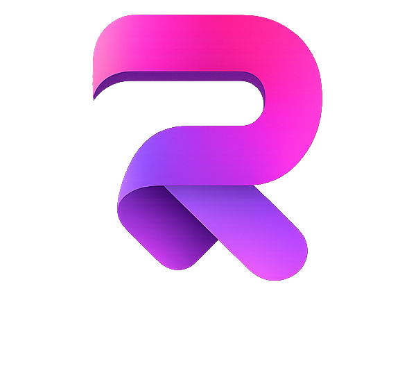
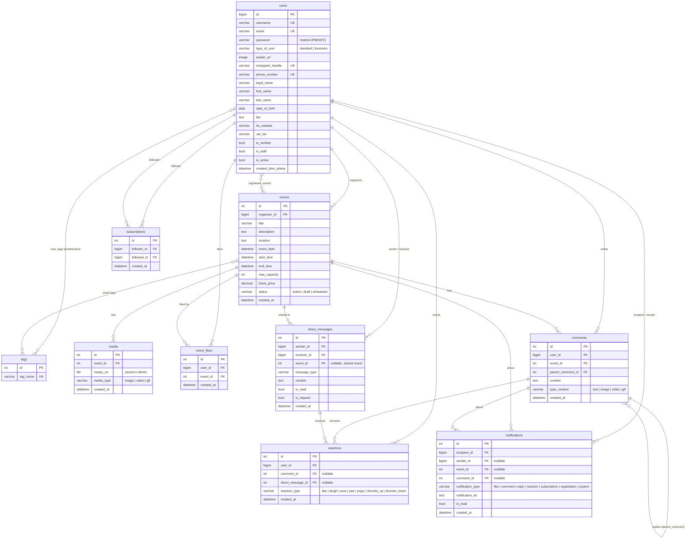

*This project has been created as part of the 42 curriculum by [lemarino](https://github.com/Leo-Marino), [xhamzall](https://github.com/HamzallariXhuljano), tkurukul, [ilmahjou](https://github.com/Ilyas-Mahjoubi), [adegl-in](https://github.com/ffuze).*

# Ready2Roll

<p align="center">
  
</p>

## Description

**Ready2Roll** is a web platform for organizing, publishing and advertising social events.
Business accounts (venues, promoters, organizers) publish events with a poster image or video;
standard users discover them through a personalized feed, follow the accounts they like,
comment, react, chat with each other and ask an AI assistant ("Rolly") anything about an event.

The goal of the project is to build a complete, secure, multi-user web application —
frontend, backend, database, real-time layer and hardened infrastructure — deployable
with a single command.

### Key features

- **Two account types**: *standard* accounts for attendees and *business* accounts that can publish events.
- **Onboarding by interests**: users pick preference tags that drive their recommendations.
- **Event publishing**: title, description, location, date/time, capacity, ticket price, tags, and one poster (image or MP4 video).
- **Personalized feeds**: *For you* (based on preferences and behaviour), *Discover* (search/explore all events) and *Subscriptions* (events from followed accounts).
- **Social interactions**: follow/unfollow accounts, like events, threaded comments, emoji reactions.
- **Real-time chat**: live 1-on-1 direct messages with message requests, unread counters and event sharing.
- **Real-time notifications**: likes, comments, replies, reactions and new followers, pushed over WebSockets.
- **AI chatbot "Rolly"**: answers questions about an event using its live data (e.g. where the venue is, what kind of music the artists play).
- **Internationalization**: English, French and Arabic, with full right-to-left layout for Arabic.
- **Security**: WAF (ModSecurity + OWASP CRS) as the only public entry point, HTTPS, secrets managed by HashiCorp Vault.
- **Privacy Policy and Terms of Service** pages, linked from the footer of every page.

---

## Instructions

### Prerequisites

| Tool | Version | Notes |
|------|---------|-------|
| Docker Engine | 24+ | with the Compose v2 plugin (`docker compose`) |
| GNU Make | any | |
| jq | any | used by the Vault bootstrap script |
| OpenSSL | any | only if you need to (re)generate TLS certificates |
| Google Chrome | latest stable | Firefox, Safari and Edge are also supported |

> The Makefile stores persistent data (PostgreSQL, MinIO, Redis) under
> `/sgoinfre/$USER/ready2roll`, the shared storage of the 42 school machines.
> On another machine, change `DATA_DIR` in the `Makefile` and the MinIO volume path in `compose.yaml`.

### Configuration

Credentials are **never** committed. They live in HashiCorp Vault and are injected
at runtime by the Vault Agent into RAM-backed (`tmpfs`) volumes.

1. **Application secrets** — copy the template and fill in every value:

   ```bash
   cp r2r-secrets.json.example r2r-secrets.json
   ```

   | Key | Description |
   |-----|-------------|
   | `SECRET_KEY` | Django secret key |
   | `POSTGRES_USER`, `POSTGRES_PASSWORD`, `POSTGRES_DB`, `POSTGRES_HOST`, `POSTGRES_PORT` | Database connection (`POSTGRES_USER` must be `r2r_admin`, `POSTGRES_DB` must be `ready2roll`, host `postgre_db`, port `5432`) |
   | `DJANGO_SUPERUSER_USERNAME`, `DJANGO_SUPERUSER_PASSWORD`, `DJANGO_SUPERUSER_EMAIL` | Admin account created automatically at first start |
   | `MINIO_USER`, `MINIO_PASSWORD`, `MINIO_ENDPOINT`, `MINIO_ACCESS_KEY`, `MINIO_SECRET_KEY`, `MINIO_SECURE` | Object storage for avatars and event media |
   | `REDIS_URL` | e.g. `redis://:<redis_password>@redis_cache:6379/0` |
   | `CHATBOT_API_KEY` | Google Gemini API key for the "Rolly" chatbot |
   | `EMAIL_HOST_PASSWORD` | SMTP password |

2. **Bootstrap secrets** — files read directly by Docker (create them with `printf`, not `echo`, so there is no trailing newline):

   ```bash
   mkdir -p secrets
   printf '%s' '<same as POSTGRES_PASSWORD>' > secrets/pg_root_password.txt
   printf '%s' '<same as the password in REDIS_URL>' > secrets/redis_password.txt
   printf '%s' '<any password>' > secrets/pgadmin_password.txt
   ```

3. **TLS certificates** — the WAF expects `srcs/waf/certs/server.crt` and `server.key`;
   Vault expects `srcs/vault/tls/ca.crt`, `vault.crt` and `vault.key`.

### Running the project (single command)

```bash
make run-app
```

`run-app` runs two scripts (gen-certs.sh and vault-bootstrap.sh) that performs every step needed to go from a clean clone to
a running application: it builds and starts all containers, initializes and unseals
Vault, configures the secrets engine and AppRole authentication.
All vault keys will be stored in secrets/vault-init.json

Then open **https://localhost:8443** in your browser (the certificate is self-signed,
so accept the browser warning).

### Alternative: step-by-step sequence

The same result can be reached manually:

```bash
make up            # 1. create data directories, build images and start all containers
make keygen        # 2. initialize Vault: prints 5 unseal keys and the root token — store them safely
make unseal        # 3. unseal Vault (asks for 2 of the 5 keys, then the root token) and restart the Vault Agent
make enable        # 4. one-time setup: audit log, kv-v2 engine at r2r/, read-only policy,
                   #    AppRole for Django, and writes secrets/approle/{role_id,secret_id}
make loadsecrets   # 5. upload r2r-secrets.json into Vault (r2r/django)
                   # 6. let the services pick up the freshly rendered secrets
make restore-all   # 7. (optional) load the demo database and media
```

After a reboot, Vault starts **sealed** again: only `make up` and `make unseal` are needed.

### Other useful commands

| Command | Effect |
|---------|--------|
| `make down` / `make restart` / `make reup` | Stop / restart / recreate the containers |
| `make vault-status` | Show whether Vault is initialized and sealed |
| `make save-all` / `make restore-all` | Export / import the database (`demo_data.json`) and MinIO media (`media_backup.tar.gz`) |
| `make clean` | Stop the containers and remove the volumes |
| `make fclean` | Same as `clean`, plus prune all Docker images and the Vault init file |
| `make re` | `fclean` + `up` |

### Architecture

```
browser ──HTTPS:8443──► waf (ModSecurity + OWASP CRS, TLS)
                          │
                          ▼
                        nginx (internal router)
              ┌───────────┼──────────────┐
              ▼           ▼              ▼
          vuejs (/)   django (/api, /ws)  minio (/media/)
                          │
             ┌────────────┼──────────────┐
             ▼            ▼              ▼
         PostgreSQL     Redis      Vault Agent ◄── Vault
```

Docker networks are segmented so that only the WAF is exposed:
`edge` (public), `app`, `data`, `secrets` and `vaultdb` are all internal; no application
container can reach Vault directly — it only reads the files rendered by the Vault Agent.

---

## Team Information

| Member | 42 login | Role(s) | Responsibilities |
|--------|----------|---------|------------------|
| Leonardo | `lemarino` | Project Manager / Scrum Master, DevOps / Infrastructure Lead | Organizes the work and the meetings, tracks progress and blockers, keeps the team aligned; designs and maintains the containerized infrastructure (Docker Compose, WAF, Vault, networking, Makefile). |
| Xhuljano | `xhamzall` | Product Owner, Back-end Developer | Defines the product vision and the feature priorities, validates completed work; implements back-end features and APIs. |
| Thilina | `tkurukul` | Tech Lead / Architect, Database | Defines the technical architecture and stack, ensures code quality and reviews critical changes; designs the database schema and relations. |
| Ilyas | `ilmahjou` | Front-end Developer | Implements user-facing views and components of the Vue application. |
| Alek | `adegl-in` | Front-end Developer | Implements user-facing views and components of the Vue application. |

---

## Project Management

- **Work organization**: the team met **daily, in person**, at 42 Firenze to sync on progress,
  split the upcoming tasks and solve blockers together. Work was divided by area of
  responsibility (infrastructure, back end, database, front end) and each member owned
  the features of their area.
- **Tools**: **GitHub** was used to share and integrate the work (feature branches merged into `main`).
- **Communication**: mostly face-to-face during the daily meetings.

---

## Technical Stack

| Layer | Technologies |
|-------|--------------|
| Frontend | Vue 3, Vite, Vue Router, Pinia, Zod; plain scoped CSS in single-file components |
| Backend | Django 5.2, Django REST Framework, SimpleJWT, Django Channels, Daphne |
| Database | PostgreSQL 16 (via the Django ORM) |
| Real time | Django Channels + Redis 7 (channel layer / pub-sub) |
| File storage | MinIO (S3-compatible) via `django-storages` + `boto3` |
| AI | Google Gemini (`google-genai`) |
| Security | ModSecurity v3 + OWASP Core Rule Set (WAF), HashiCorp Vault 1.18 + Vault Agent (AppRole), TLS |
| Infrastructure | Docker, Docker Compose, Nginx, GNU Make |

---

## Database Schema

PostgreSQL 16, managed through the Django ORM (10 models).



**Integrity constraints**

- `subscriptions`: unique (`follower`, `followed`) — a user can follow an account only once.
- `event_likes`: unique (`user`, `event`) — one like per user per event.
- `reactions`: unique (`user`, `comment`) and unique (`user`, `direct_message`) — one reaction per user per target.
- All foreign keys use `ON DELETE CASCADE`: deleting a user or an event removes its dependent rows.

---

## Features List

| Feature | Description | Team member(s) |
|---------|-------------|----------------|
| Sign up / log in | Email + password registration (hashed and salted passwords), JWT authentication | _Alek_ |
| Standard and business accounts | Only business accounts can publish events | _Alek_ |
| Onboarding with preference tags | Users choose the tags that personalize their feed | _Alek_ |
| Profile management | Edit profile information, upload avatar (with default fallback), view other users' profiles | _Ilyas, Alek_ |
| Event publishing | Create/edit events with details, tags and one poster image or MP4 video | _Alek_ |
| *For you* feed | Recommended events based on preferences and behaviour | _Xhuljano, Ilyas_ |
| *Discover* page and search | Explore and search all events and users | _Xhuljano, Ilyas_ |
| *Subscriptions* feed | Events published by followed accounts | _Xhuljano, Ilyas_ |
| Follow system | Follow/unfollow accounts, followers/following lists | _Xhuljano_ |
| Likes, comments and reactions | Like events, threaded comments, emoji reactions on comments | _Thilina, Ilyas_ |
| Real-time chat | Live 1-on-1 messages, message requests, unread counters, event sharing | _Thilina, Ilyas_ |
| Real-time notifications | Notification bell with read/unread state, pushed over WebSockets | _Xhuljano, Thilina, Ilyas_ |
| AI chatbot "Rolly" | Answers questions about an event using its data | _Xhuljano_ |
| Languages | English, French, Arabic with a language switcher | _Ilyas_ |
| RTL layout | Full mirrored layout when Arabic is selected | _Ilyas_ |
| Privacy Policy / Terms of Service | Legal pages linked in the footer | _Ilyas_ |
| Containerized infrastructure | Docker Compose stack, single-command start, data backup/restore | _Leo_ |
| WAF + Vault | Hardened entry point and centralized secrets management | _Leo_ |

---

## Modules

**Total: 20 points** — 7 Major modules (14 pts) + 6 Minor modules (6 pts).

| # | Module | Category | Type | Points | Implementation | Team member(s) |
|---|--------|----------|------|--------|----------------|----------------|
| 1 | Use a framework for both the frontend and backend | Web | Major | 2 | Vue 3 (Vite, Vue Router, Pinia) + Django 5.2 / DRF / Daphne | _all_ |
| 2 | Real-time features using WebSockets | Web | Major | 2 | Django Channels + Redis pub/sub (`DMConsumer`, `SocialConsumer`, auto-resync on reconnect) | _Xhuljano, Thilina_ |
| 3 | User interaction (chat, profiles, friends/follow) | Web | Major | 2 | Live 1-on-1 DMs (`ChatView.vue`), profiles, follow/subscriptions, comments and reactions | _all_ |
| 4 | Standard user management and authentication | User Management | Major | 2 | Standard/business accounts, profile edit, avatar upload with default fallback, followers | _all_ |
| 5 | Complete LLM system interface ("Rolly") | Artificial Intelligence | Major | 2 | `events/ai.py` + `RChat.vue`: Gemini API with fallback model, live event context, rate limit of 10 requests/min per user | _Thilina, Xhuljano, Ilyas_ |
| 6 | Recommendation system | Artificial Intelligence | Major | 2 | `events/recommender.py`: content-based (tags) + behavioural (likes, trending) filtering for the *For you*, *Discover* and *Following* feeds | _Xhuljano, Ilyas_ |
| 7 | WAF/ModSecurity (hardened) + HashiCorp Vault for secrets | Cybersecurity | Major | 2 | OWASP ModSecurity CRS + TLS as sole entry point; Vault in server mode (Raft storage, TLS), AppRole auth, Vault Agent rendering secrets to `tmpfs` | _Leo_ |
| 8 | Use an ORM for the database | Web | Minor | 1 | Django ORM on PostgreSQL 16 (10 models, constraints, `annotate`, `prefetch_related`) | _Thilina_ |
| 9 | Complete notification system | Web | Minor | 1 | `notifications` app + WebSocket push (`NotificationBell.vue`, read/unread state) | _all_ |
| 10 | File upload and management system | Web | Minor | 1 | MinIO S3 storage (`MediaStorage`), image/video upload and preview | _Thilina_ |
| 11 | Support for multiple languages (3+) | Accessibility & i18n | Minor | 1 | `i18n.js` + `LanguageSwitcher.vue`: English, French, Arabic | _Ilyas_ |
| 12 | Right-to-left (RTL) language support | Accessibility & i18n | Minor | 1 | Full `[dir="rtl"]` layout mirroring across `App.vue`, `HomePage.vue`, `ProfileView.vue`, etc. | _Ilyas_ |
| 13 | Support for additional browsers | Accessibility & i18n | Minor | 1 | Tested on Chrome, Firefox and Brave | _all_ |


---

## Resources

### Documentation

- [Vue.js](https://vuejs.org/guide/introduction.html) · [Vue Router](https://router.vuejs.org/) · [Pinia](https://pinia.vuejs.org/) · [Vite](https://vite.dev/guide/)
- [Django](https://docs.djangoproject.com/en/5.2/) · [Django REST Framework](https://www.django-rest-framework.org/) · [Simple JWT](https://django-rest-framework-simplejwt.readthedocs.io/)
- [Django Channels](https://channels.readthedocs.io/) · [Redis](https://redis.io/docs/latest/)
- [PostgreSQL 16](https://www.postgresql.org/docs/16/)
- [MinIO](https://min.io/docs/minio/linux/index.html) · [django-storages](https://django-storages.readthedocs.io/)
- [Google Gemini API](https://ai.google.dev/gemini-api/docs)
- [HashiCorp Vault](https://developer.hashicorp.com/vault/docs) · [Vault Agent](https://developer.hashicorp.com/vault/docs/agent-and-proxy/agent) · [AppRole](https://developer.hashicorp.com/vault/docs/auth/approle)
- [OWASP ModSecurity Core Rule Set](https://coreruleset.org/docs/) · [owasp/modsecurity-crs Docker image](https://github.com/coreruleset/modsecurity-crs-docker)
- [Docker](https://docs.docker.com/) · [Docker Compose](https://docs.docker.com/compose/) · [Nginx](https://nginx.org/en/docs/)
- [GeeksforGeeks](https://www.geeksforgeeks.org/) — tutorials and articles on Django, Vue.js and web development concepts

### Use of AI

The team used **Claude** and **Gemini** as learning and support tools:

- **Tutorials**: generating step-by-step explanations of technologies that were new to the team.
- **Debugging**: helping to analyze error messages and logs and to find the cause of bugs.

All code produced with the help of AI was reviewed, understood and tested by the team members
before being integrated. Separately from development, the application itself uses the
Google Gemini API as a runtime feature (the "Rolly" chatbot, see [Modules](#modules)).

---

## License

This project was developed for educational purposes as part of the 42 curriculum.
